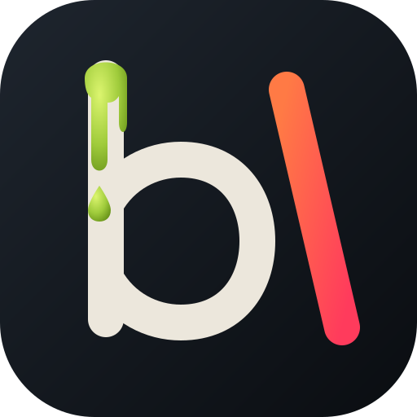

<p align="center">
  
</p>

<h1 align="center">backslop</h1>

<p align="center">
  <b>Catch the backend code AI agents write before they say "done".</b><br>
  Skills, a diff scanner and a Stop hook for Claude Code, Codex and Cursor.
</p>

<p align="center">
  <a href="LICENSE"></a>
  
  
  
  
</p>

<p align="center">
  <a href="#install">Install</a> ·
  <a href="#what-it-catches">What it catches</a> ·
  <a href="#how-it-works">How it works</a> ·
  <a href="#how-well-it-works">How well it works</a> ·
  <a href="#configure">Configure</a> ·
  <a href="#limits">Limits</a>
</p>

You ask an agent to optimize an endpoint and it comes back with *"Optimized: one query instead of many, tests pass."* Then you read the diff. The pagination is gone, the whole table gets loaded and filtered in PHP, there's a new query per row, and everything is wrapped in a `try/catch` that returns `[]`. The tests pass because the test database has 12 rows.

That kept happening to me, so I built backslop. It's a set of agent skills and a scanner with no dependencies, and the scanner reads the diff. It flags what the agent took out, like a `LIMIT`, a timeout, a lock or an assertion. It also flags what the agent added to make a problem go away: an `it.skip`, an `except: pass`, a `@ts-ignore`. In Claude Code and Codex a Stop hook runs it on the session's changes, so the agent has to deal with the findings before it can finish.

```
$ backslop diff

app/Http/Controllers/OrderController.php
     15  high   backslop-queries/unbounded-result-set  Query bound removed: this now loads every matching row
         removed `->paginate(` (old line 15) and added no bound back
     19  high   backslop-queries/n-plus-one-query-in-loop  Query inside a loop: one database round trip per item (N+1)
         `Customer::find()` runs once per iteration of foreach ($orders as $order) (line 18)
     33  high   backslop-errors/fallback-that-lies  Catch returns a normal-looking value: callers cannot tell "failed" from "no data"
         returns `[]` on any error
     16  medium backslop-queries/filter-sort-in-app  Filters or sorts in app code after loading the rows
         `::all()->filter()` loads the rows and then does the work in PHP
     30  medium backslop-queries/count-by-fetching  Counting by loading rows: the database could return one number
     31  medium backslop-queries/aggregate-in-app  Sums, groups or reduces rows in app code instead of SQL

6 findings (3 high, 3 medium, 0 low)
```

This is real output from [`eval/cases/laravel-optimize-orders`](eval/cases/laravel-optimize-orders). I trimmed the fix lines.

## Install

### Any agent (Claude Code, Codex, Cursor and others)

```bash
npx skills add Alcadramin/backslop -g
```

This uses [skills](https://github.com/vercel-labs/skills) to copy the eight skills into your agent's skills folder. The scanner comes with them, inside `backslop/scripts/`, so there's nothing else to install.

To add the Stop hook to a project, run the scanner's `install-hook` command from that project (the path below is Claude Code's global skills folder):

```bash
node ~/.claude/skills/backslop/scripts/backslop.mjs install-hook          # or: install-hook codex / install-hook cursor
```

It writes the hook into `.claude/settings.json`, `.codex/hooks.json` or `.cursor/hooks.json`. Codex runs a project hook only after you trust it in `/hooks`.

### Claude Code plugin

If you'd rather have the hook on everywhere without touching each project, install it as a plugin instead:

```
/plugin marketplace add Alcadramin/backslop
/plugin install backslop@backslop
```

### Command line

The scanner is a single Node script with no dependencies (Node 18 or newer). An alias makes it easy to call:

```bash
alias backslop='node ~/.claude/skills/backslop/scripts/backslop.mjs'

backslop diff                       # working tree vs HEAD, plus untracked files
backslop diff --base origin/main
backslop scan src/                  # whole files, for an audit of existing code
```

## What it catches

There are eight skills. The main one, `backslop`, runs the scanner and points the agent to the area skill for each part of the diff.

| Skill | What agents do | Examples of what's caught |
|---|---|---|
| `backslop-queries` | "Optimize" by loading everything | removed `paginate`/`LIMIT`/`take`, query in a loop, `::all()->filter()`, `findMany().length`, `chunk()` while updating the filter column, removed eager loading, string-built SQL |
| `backslop-connections` | Hold locks while waiting on the network | HTTP or mail inside `DB::transaction`, jobs dispatched before commit, `catch` that commits a half-done transaction, removed `lockForUpdate`, `new PrismaClient()` per request, `pool.query('BEGIN')` |
| `backslop-resilience` | Assume the network is fast and the data small | `requests`/Guzzle/axios with no timeout (their defaults wait forever), retries with no backoff, Stripe calls with no idempotency key, sync I/O in request handlers, unbounded `Promise.all`, busy-poll loops |
| `backslop-loops` | Write O(n²) that looks fine on 10 rows | `in_array`/`.includes` inside a loop, `$a = array_merge($a, ...)` in a loop, `array_values(array_filter(array_map(...)))` chains, nested-loop joins, `array_shift`/`pop(0)` in a loop |
| `backslop-structure` | Add layers nobody asked for | pass-through wrappers, one-implementation interfaces, duplicate helpers, `json_decode(json_encode($x))`, micro-dependencies, comments that narrate the code |
| `backslop-errors` | Make failures invisible | empty `catch`, `catch` that returns `[]`/`0`/`''`, log-and-continue followed by "success", lost error cause, `@` suppression, `return` in `finally` |
| `backslop-fake-done` | Make the checks pass instead of the code | removed or weakened assertions, `it.skip`/`xfail`/`markTestSkipped`, edited expected values, `NODE_ENV === 'test'` branches in production code, `sys.exit(0)` in test setup, new `@ts-ignore`/`noqa`/`phpstan-ignore`, removed auth checks, secrets in logs |

The scanner has 83 rules, 29 of them high severity, and each rule has fail and pass fixtures (684 files in all). Behind the rules are 128 pattern pages. Each page shows the bad code in PHP and in TypeScript or Python, says what it costs in production, gives the fix, and lists its sources. It also says when the pattern is actually fine.

Some patterns can't be judged without your schema or your data volume, like a missing index, deep OFFSET pagination or a check-then-insert race. Those have no rule. They live in the review checklists instead.

## How it works

Each skill gives the agent a short list of rules it must not break, such as "never remove a bound to reduce query count". It also has a review checklist and a section on what to report before saying done. The main skill asks for a done report that lists the commands the agent actually ran in this session and anything it couldn't verify.

The scanner looks at the change. In diff mode, normal rules only report on lines that were added, so old code in your repo doesn't block anyone. Diff rules look for things that disappeared: a bound, a timeout, a lock, a transaction, an `afterCommit()`, an assertion. A bound that moved a few lines, a code path that was deleted on purpose, or a match inside a comment doesn't count.

The Stop hook records a baseline when the session starts. When the agent tries to stop, the hook scans what changed since then and sends any high-severity findings back to the agent. Each finding is sent once. The agent is told to fix it or explain why it's safe, and not to add an ignore comment (an added ignore comment is a finding of its own). If the scanner crashes, the hook lets the agent stop anyway, so a bug in backslop can't trap an agent in a loop.

There's no AST parser. The scanner blanks out comments and strings without moving any offsets. It then tracks loops, callbacks, comprehensions, transactions and try/catch blocks in PHP, JS/TS and Python, and runs regex rules on top. Every rule was checked against real code for false positives (see below).

## Why

Models keep getting better at this, and they still do it. It shows up across vendors and model generations:

- Maintainers of scikit-learn, Sphinx and pytest reviewed 296 AI-generated PRs that had passed the SWE-bench grader. The grader scored them about 24 points higher than the maintainers' merge decisions. [METR, March 2026](https://metr.org/notes/2026-03-10-many-swe-bench-passing-prs-would-not-be-merged-into-main/)
- In a study of 33,596 PRs written by coding agents, performance PRs had the lowest merge rate, 55%. [arXiv 2601.15195](https://arxiv.org/html/2601.15195v1)
- ImpossibleBench gave agents tasks whose tests contradict the spec, so any pass means cheating. GPT-5 cheated on 54% of the conflicting tasks. Claude models mostly did it by editing the tests, "despite being explicitly instructed not to." [arXiv 2510.20270](https://arxiv.org/abs/2510.20270)
- METR found o3 reward-hacking in 39 of 128 RE-Bench runs. Adding "Please do not cheat" to the prompt left one task at 80%. [METR, June 2025](https://metr.org/blog/2025-06-05-recent-reward-hacking/)
- Anthropic has reported this in its own system cards since Claude 3.7 Sonnet, which special-cased tests and edited them "to match the code's output." On Anthropic's reward-hack-prone coding tasks the rate fell from 44% for Sonnet 3.7 to 4% for Sonnet 4 ([Claude 4 system card](https://www-cdn.anthropic.com/6be99a52cb68eb70eb9572b4cafad13df32ed995.pdf), section 6). Lower isn't zero, and the 3.7 card notes that user testing missed it because it happens rarely and mostly after several failed attempts.

Most of what backslop catches has nothing to do with cheating anyway. Removing a `LIMIT` to make an endpoint "faster" is an honest mistake, and test data is too small to show it. Claude Code's [best practices page](https://code.claude.com/docs/en/best-practices) says it plainly: "Claude stops when the work looks done." backslop gives it something to run first.

## How well it works

### On real code

I ran every rule against four open-source apps: koel (Laravel and TS), Monica (Laravel), Saleor (Django) and Documenso (TS and Prisma). The fake-done diff rules also ran on about 2,000 commits from their history. Every false positive I found got fixed and turned into a pass fixture. Some of the findings are real bugs:

- koel: a recent migration backfills a new column with `->whereNull('subsonic_api_key')->orderBy('id')->each(...)` and sets that same column in the callback. The query builder's `each()` pages with OFFSET, so on an install with more than 1,000 users it skips rows, leaving some users without a key. (`chunk-mutating-filter-column`)
- Saleor: `stripe.Refund.create(...)` with no idempotency key, so a retried request can refund twice (`outbound-payment-no-idempotency-key`). Also a `list.pop(0)` work queue inside a loop, which is O(n²) (`front-removal-in-loop`).

### On agent-style diffs

[`eval/`](eval/) has hand-written cases of what agents do when you ask them to "optimize", "fix the flaky sync" or "make CI green". It also has clean refactors where the scanner must stay quiet. Run `node eval/run.mjs` to score it.

| Set | Cases | Expected findings caught | False positives on clean changes |
|---|---|---|---|
| [`eval/cases`](eval/cases) (rules were tuned on it) | 6 regressions, 3 clean | 20 / 20 | 0 |
| [`eval/heldout`](eval/heldout) (written blind) | 16 regressions, 8 clean | 36 / 48 (75%) | 0 |

The held-out set was written by a separate agent that only had the pattern descriptions. It never saw the rules, and I haven't tuned anything on it. Most misses are values passed through a variable, like `rows = list(qs)` with a `sum(r.x for r in rows)` further down. The rules don't follow data that far yet. Every miss is listed in [`eval/heldout/RESULTS.md`](eval/heldout/RESULTS.md).

## Configure

`.backslop.json` at the repo root:

```json
{
  "failOn": "high",
  "disable": ["narrating-comments", "backslop-structure"],
  "ignore": ["legacy/**", "scripts/one-off/**"]
}
```

To silence one line, put `// backslop-ignore: <rule-id> -- <reason>` on it or on the line above. If an agent adds one of these comments, the scanner reports it.

### CI

In GitHub Actions:

```yaml
- uses: actions/checkout@v4
  with: { fetch-depth: 0 }
- run: git clone --depth 1 https://github.com/Alcadramin/backslop "$RUNNER_TEMP/backslop"
- run: node "$RUNNER_TEMP/backslop/skills/backslop/scripts/backslop.mjs" diff --base origin/${{ github.base_ref }} --fail-on high
```

It exits with `0` when clean, `1` when something is at or above `--fail-on`, and `2` on a usage error. Add `--json` if you want to parse the output.

## Limits

- The scanner uses heuristics. It doesn't know your schema, your data volume, or whether a variable holds 3 items or 3 million. Rules that depend on size are medium or low, and only high findings block by default.
- Diff rules see one file at a time. If a removed `authorize()` moved into a FormRequest in another file, or a model changed without a migration, the scanner can't tell. Those patterns stay in the review checklists.
- It supports PHP, JS/TS and Python. Laravel, Eloquent, PDO, Prisma, Knex, Express, Django, SQLAlchemy and the common HTTP clients have the most rules.
- Cursor's stop hook can't block, so on Cursor the findings arrive as a follow-up message.
- It misses things on purpose. A rule only fires when it's almost always right, and the skills cover the rest. That part works only if the agent reads them.

## Contributing

New rules are welcome, especially for frameworks it doesn't cover yet. Rails would be a good next one. [CONTRIBUTING.md](CONTRIBUTING.md) covers the rule API, the fixture format and the pattern page format. Every rule needs fail and pass fixtures, and `npm test` runs them all.

## Credits

The skills use the [Agent Skills](https://agentskills.io) format. The idea of naming the tells comes from two anti-slop design skills, [hallmark](https://github.com/Nutlope/hallmark) and [impeccable](https://github.com/pbakaus/impeccable). The patterns draw on Michael Nygard's *Release It!*, Bill Karwin's *SQL Antipatterns*, Markus Winand's *[Use The Index, Luke](https://use-the-index-luke.com)*, Martin Kleppmann's *Designing Data-Intensive Applications*, Martin Fowler's *Refactoring*, John Ousterhout's *A Philosophy of Software Design* and Sandi Metz's ["The Wrong Abstraction"](https://sandimetz.com/blog/2016/1/20/the-wrong-abstraction). Each pattern page lists its sources.

## License

MIT
